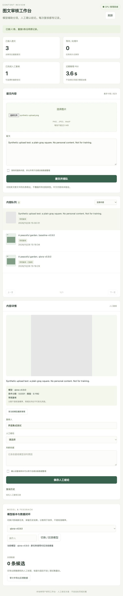

# v0.10.0 本地应用验收 · 2026-10-28

本次补齐社区英文图文投稿审核的本地工程流程。模型仍为 v0.9.0 冻结的 Qwen2-VL-2B + QLoRA 适配器；没有改变原训练数据、权重或测试阈值。

## 已验证

- 54 项单元/接口回归测试通过，含原有实验协议与新服务测试，见 tests.txt。
- Windows Python 3.11.9 / torch 2.6.0+cu124 / RTX 4060 Laptop；pip check 无损坏依赖，实际版本见 environment.json。
- 通过 HTTP 提交合成花园图文，主模型和基线均由真实 CUDA 执行，幂等重发沿用原结果，最后恢复主模型；见 cuda-smoke.json。
- 主模型该合成请求 4.621 秒，基线 0.671 秒。只有两条请求、配文含不同版本标识，且首条存在热身效应，**不能据此比较两个模型的速度或质量**。时间不含排队和模型加载。
- 浏览器真实文件选择、上传、排队与评分通过，额外灰色方块样例输出条件分数约 0.0331。网页保存合成花园样例的测试复核结论，历史 v1 可查看。均非真人盲审，未授权训练。
- 固定留出集校验 1,500 条：500 开发集 + 1,000 test_seen；导出 0 条，train_ready=false。合成与未授权内容未进入反馈训练。
- 空闲 worker 正常响应停止请求、释放独占锁后重新启动；既有任务和复核仍保留。见 worker-stop.json。单元测试另外验证了租约失效后的重新认领和迟到结果拒绝。
- 所有新增 Python 源码使用 Black 格式化，添加 VS Code API / CUDA worker 调试项。原有冻结实验文件保持原样。

## 实际边界

这是单机、单用户、回环监听的可操作系统。未接真实线上流量，未实施多人鉴权或高并发压测。监控为本地实际请求统计，不能推算线上准确率、吞吐或业务收益。

反馈导出和已有 SFT 的交接入口已实现；没有真实授权人工反馈，本轮没有启动新反馈训练、没有发布新的适配器。最低训练样本门槛仅为工程防空检查。原 v0.9.0 的离线 AUROC、AUPRC、召回率与误报/漏报权衡应单独引用。

完整操作和接口见 [工程说明](../../docs/service.zh-CN.md)。
